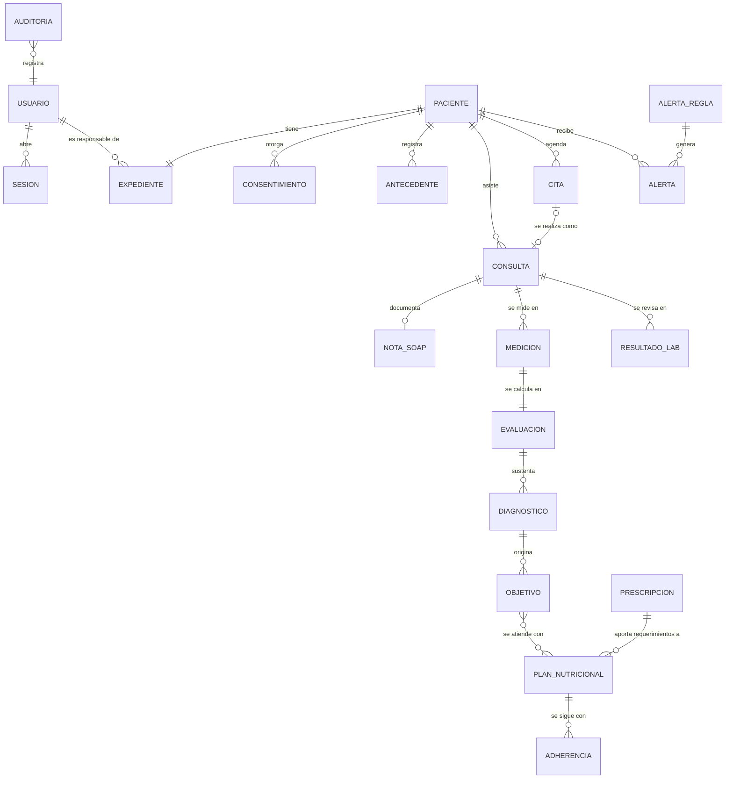

# La Nutria · Arquitectura clínica

> Documento técnico de diseño. Describe criterios de diseño clínico aplicados en el software;
> **no** constituye una validación ni un aval de profesionales sanitarios. Antes de usarse en
> atención real debe revisarlo un profesional de la nutrición y un responsable de cumplimiento.

## 1. Estado previo (análisis del repositorio)

| Área | Existía | Problema detectado |
|---|---|---|
| Pacientes | `Paciente` (nombre, edad, contacto, objetivo, peso, estatura, estado, dietaId) | Sin fecha de nacimiento, sin expediente, sin responsable, `edad` estática |
| Mediciones | `Medicion` versionada + `Evaluacion` (motor de fórmulas) | Laboratorio mezclado con antropometría, sin rango de referencia ni vínculo a consulta |
| Objetivos | Campos `pesoObjetivoKg`, `cinturaObjetivoCm`… dentro de `Prescripcion` | Objetivos sin diagnóstico ni periodo; duplicados con la prescripción |
| Antecedentes | Texto libre en `localStorage` del navegador | Sin historial, sin estado, no compartido entre equipos |
| Consultas | `Cita` (agenda) | Sin nota clínica, sin SOAP, sin firma |
| Usuarios/permisos | **No existían** (solo cabecera `X-Responsable`) | Cualquiera con acceso a la API podía leer expedientes |
| Alertas | Banderas calculadas en el dashboard | No configurables, sin estado de revisión |

## 2. Modelo de información longitudinal

Cadena clínica: **Paciente → Expediente → Consultas → Mediciones/Laboratorio → Evaluaciones →
Diagnósticos → Objetivos → Planes nutricionales → Seguimiento (adherencia, citas) → Resultados**.

### Reglas de integridad

1. Toda colección clínica guarda `pacienteId` (índice) y, cuando aplica, `consultaId`, `registradoPor` (usuario) y fecha.
2. `Diagnostico.evaluacionId` / `medicionId` apuntan a la evidencia que lo sustenta y se validan contra el mismo paciente.
3. `Objetivo.diagnosticoId` + `indicador` + `periodo { inicio, fin }` + `revisiones[]`.
4. `PlanNutricional.objetivoIds[]` y `prescripcionId` (requerimientos). El plan conserva un **snapshot**
   de los requerimientos al momento de emitirse.
5. `ResultadoLaboratorio` conserva `fecha`, `valor`, `unidad`, `rangoReferencia`, `procedencia` (laboratorio) y `metodo`.
6. Una consulta puede compararse con la anterior por `fecha` dentro del mismo paciente.
7. Antecedentes (alergias, medicamentos…) son registros con `estado` (activo/resuelto/suspendido) y
   `historial[]`; la **ficha vigente** se calcula con los registros activos, sin copiarlos.
8. Los dashboards leen de estas colecciones; no hay datos de demostración en producción.

### Versiones y no-borrado

- Mediciones: nueva versión por corrección (`grupoId`, `version`, `vigente`).
- Notas SOAP: `borrador` → `firmada` (inmutable). Las correcciones son **adendas** con autor y fecha.
- Antecedentes, objetivos y planes: `historial[]` de cambios con autor, fecha y campos.
- Pacientes con registros clínicos no se eliminan: pasan a `baja` (NOM-004: conservación ≥ 5 años).

## 3. Seguridad

| Control | Implementación |
|---|---|
| Autenticación | Usuario + contraseña (scrypt con sal), sesión con token aleatorio (se guarda solo su hash) |
| Sesiones | Expiración absoluta (12 h) e inactividad (30 min), revocación al cerrar sesión, límite de intentos |
| Autorización | Roles `administrador`, `nutriologo`, `asistente`; permisos por acción; acceso a expedientes por responsable |
| Cifrado | AES-256-GCM a nivel de campo (contacto, notas SOAP, antecedentes) con `CLAVE_CIFRADO` |
| Auditoría | Accesos y modificaciones (quién, qué, cuándo, IP), sin valores clínicos |
| Respaldo | `npm run respaldo` / `npm run restaurar` (JSON cifrado) |
| Conservación | Configuración de años mínimos; bloqueo de borrado de expedientes con información clínica |
| Consentimiento | Registro de aviso de privacidad y consentimiento expreso para datos de salud (versión, fecha, medio) |

## 4. Marco normativo considerado (verificado en noviembre de 2026)

- **NOM-004-SSA3-2012**, Del expediente clínico (DOF 15/10/2012): vigente. Conservación mínima de 5 años desde el último acto médico; notas con fecha, hora, nombre y firma de quien las elabora.
- **NOM-024-SSA3-2012**, Sistemas de información de registro electrónico para la salud (DOF 30/11/2012): vigente (ratificada en revisión sistemática de 2018). Pide identificación unívoca, control de acceso, bitácora y uso de catálogos fundamentales de la DGIS.
- **Ley Federal de Protección de Datos Personales en Posesión de los Particulares** (DOF 20/03/2025, reforma 14/11/2025): los datos de salud son sensibles y requieren consentimiento expreso y por escrito (art. 8), con excepciones del art. 9.

Estas referencias orientan el diseño; el cumplimiento formal requiere revisión legal y, en su caso, certificación de la DGIS.

## 5. Interoperabilidad

`backend/src/Services/fhir/` traduce recursos internos a HL7 FHIR R4 (`Patient`, `Observation` con LOINC
para peso, estatura, IMC, cintura y laboratorio). Es de solo lectura y no altera el modelo interno.

## 6. Etapas

1. **Fundamentos de seguridad** – usuarios, sesiones, roles, cifrado, auditoría de accesos.
2. **Modelo clínico** – expediente, antecedentes, consultas SOAP, laboratorio, diagnósticos, objetivos, planes, consentimiento; migración.
3. **Inteligencia clínica** – línea de tiempo, alertas configurables, ficha vigente, comparación entre consultas, FHIR.
4. **Interfaz clínica** – sistema visual claro, navegación de 11 secciones, ficha del paciente con pestañas, Recharts.
5. **Documentación** – reportes imprimibles/PDF con versión de registro y modo "para terceros".
6. **Pendientes** – adjuntos (requiere almacenamiento cifrado), catálogos oficiales completos (CIE-10, medicamentos) mediante importación, firma electrónica avanzada (e.firma).
